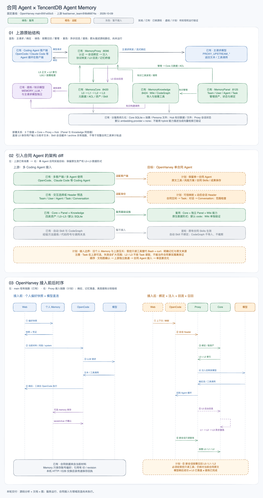

# TencentDB Agent Memory 引入合同 Agent：结构分析与实验方案

状态：**待方案确认；文档与图已交付，服务和接入尚未运行**。分析日期：2026-10-09（Asia/Shanghai）。

## 1. 结论与实验边界

建议保留上游 Core、Proxy、Panel、Knowledge 与既有数据形式，通过 OpenHarvey 已使用的 OpenCode 接入 Proxy，先验证原生记忆闭环，再逐项调整合同业务行为。首阶段的主要工作在接入边界：业务身份与会话传递、Task 范围检查、检索工具权限、原有个人记忆互斥及合同证据语义。

上游已有团队实体、四类资产、固定绑定、可见性与 ACL；这些提供可复用的基础设施，但并不证明固定版本已经适配合同业务。**单一合同 Agent 可以使用团队基础设施；它不需要多 Agent 编排，也不能因此取消账号与合同范围检查。**

本轮只新增本文件及 Excalidraw 差异图，不启动上游或 OpenHarvey，不改运行代码、数据库、模型配置和现有记忆。服务运行及接入属于方案确认后的阶段 A／B。

### 固定基线

| 项目 | 固定版本 | 用途 |
|---|---|---|
| OpenHarvey | `main@81e55c5c3e6049f5d2a2bc28b195634cf3d21a7f` | 合同 Agent 实验基线 |
| TencentDB Agent Memory | `feat/server_team@8b86874a2daea49e3ff0fb53d699203146c5c77d` | 上游结构、接口及部署行为的分析基线 |
| OpenCode | 首次运行目标为隔离安装 `1.16.2` | 与 OpenHarvey main 的运行要求一致 |

OpenHarvey 原检出为 `codex/local-dev`，含尚未进入 main 的知识管理与未提交文件。它们不参与本实验，也未迁移或覆盖。本次文档在从固定 main 建立的独立工作区、分支 `codex/contract-agent-memory-analysis` 中交付。

图：[可编辑 Excalidraw](../diagrams/tencentdb-agent-memory-diff.excalidraw) · [PNG 预览](../diagrams/tencentdb-agent-memory-diff.png)。图中“已有／计划”标记说明能力状态；颜色仅表示复用、适配或暂不接入，不表示测试已通过。

## 2. 上游结构与真实数据流

### 2.1 服务与部署单元

| 源码模块 | 职责 | 默认部署单元／端口 | 关键边界 |
|---|---|---|---|
| MemoryProxy | LLM 协议转发、认证、会话绑定、上下文注入、L0 回流、Skill 会话缓冲、只读记忆桥接 | `memory-proxy`，8096 | 代理模型请求，不运行合同 Agent 的执行循环 |
| MemoryCore | 长期记忆 L0→L1→L2→L3、Skill、元数据与资产权限、gateway API | `memory-core`，8420 | 数据层及异步处理引擎 |
| MemoryPanel | 管理 Team／User／Agent／Task、资产、绑定与可见性；查看和管理处理结果 | `memory-hub` 内，8125 | 使用上游独立管理面板 |
| MemoryKnowledge | LLM-Wiki 和 CodeGraph 的导入、索引、任务及工具接口 | 同一个 `memory-hub` 内，8424 | 源码上是独立模块，部署上与 Panel 合并 |
| 模型服务 | Proxy 主请求转发模型；Core／Knowledge 的记忆提炼与知识构建模型 | 两组独立配置 | `MEMORY_*` 与 `PROXY_*` 可使用同一供应商，职责仍不同 |
| 存储 | Core 数据与元数据、知识资料、场景与高层记忆文件、Proxy 会话状态 | 本地 SQLite／文件及持久卷 | 初次实验沿用默认 SQLite；不引入 MongoDB 或外部向量库 |

来源：[部署总入口][U1]、[Core 启动脚本][U2]、[Hub 启动脚本][U3]、[Proxy 启动脚本][U4]。不能把三个容器误画成只有三个源码模块，也不能把所有状态误画在同一个数据库中。

### 2.2 长期记忆与资产是两条组织轴

| 长期记忆层 | 上游含义 | 生成与使用方式 |
|---|---|---|
| L0 Conversation | 接收的会话记录，作为提炼和检索来源 | Proxy 回流到 Core；需要时查询历史 |
| L1 Atom／Work Record | 从对话中提取的原子记忆 | 异步抽取、去重；通过工具主动检索 |
| L2 Scenario | 聚合的场景块与索引 | 注入路径与摘要索引；正文按需读取 |
| L3 Core／Persona | 压缩的高层画像或工作方法 | 注入高层正文，并由异步管线更新 |

上游提示词支持 `chat` 与 `code` 两个族。L1 的 `chat` 抽取 persona／episodic／instruction，`code` 面向工作事实、任务、决策与可复用方法；L2、L3 同样有对应提示词。部署脚本默认 `MEMORY_PROMPT_MODE=code`，初次运行保留这个默认值。它可能认为合同对话缺少可提炼的工程内容，从而返回零条记忆；零条需要记录，不能为了让结果“看起来成功”直接更换结构。

独立于上述分层，资产类型是 `chat_memory`、`skill`、`llm_wiki`、`code_graph`。资产具有所有者、版本、状态、可见性、绑定等元数据，源码包含 `private`／`team`／`restricted`／`agent`／`task` 可见性。**四类资产不等于四个记忆层级**；Task 可见性也不等于每次检索都强制按 Task 过滤。[资产类型与元数据][U5]、[L1 提示词][U6]、[L2 提示词][U7]、[L3 提示词][U8]。

本轮沿用这套形式，不增加合同类型、审批字段或 L4。Core 配置中另有上下文卸载相关的 L1／L1.5／L2／L4 命名；它与这里的长期记忆管线不是同一套层级，不能仅凭名称合并。卸载默认配置及实际生效路径在阶段 A 单独核实。[Core 配置][U9]

### 2.3 三条关键链路

**请求与注入：**OpenCode → `/opencode/<spaceId>/v1/chat/completions` → Proxy 验证业务 `user_key` → 解析 Conversation → 绑定 Team／Agent／Task → 注入可用资产 → 转发上游模型 → 返回文本或工具调用。工具仍由 OpenCode 的合同 Agent 循环执行。

**按需召回：**当前注册逻辑注入 L3 正文与 L2 索引，并提供记忆桥接调用说明。L0／L1 自动召回注入器已经停止注册；保留的 `recallL1` 配置不能证明它仍逐轮运行。检索实际通过 `Bash + curl` 调用 `/memory-bridge/v3/*`，不是注册了同名 OpenCode 原生工具。Wiki／CodeGraph 使用 `/v3/tools/list`、`/v3/tools/call` 按需发现与调用。[注入器注册][U10]、[Profile 注入][U11]、[记忆工具说明][U12]、[Knowledge 工具说明][U13]

**回流与提炼：**成功模型响应后，Proxy 将当前人类输入和助手文本交给 `recordTdaiTurn`，写入 Core 的会话接口；Core 的后台 worker 执行 L1、L2、L3。OpenCode 工具循环末尾是 tool 消息时不会再次算作新的人类输入。流式回流使用后台写入与重试，模型响应完成不等于 L0 已落盘，也不等于高层提炼完成。[请求处理][U14]、[L0 回流函数][U15]、[Pipeline worker][U16]

该直接 L0 回流函数仅接收用户消息与助手文本，不保存整份工具调用轨迹；没有新的用户输入时会返回。若一轮先返回工具调用、后续工具循环才输出最终回答，直接回流可能未保存完整最终回答，需要阶段 A／B 实测核对。另有 Skill conversation buffer／archive 机制，不能据此声称直接 L0 就保留了合同阅读和修订的完整审计轨迹。运行验收需分别观察两条链路，不把历史会话摘要当作上传原件或真实保存回执。

部署默认配置 `embedding.provider: none`。上游 API／工具提示中的 hybrid 描述是能力描述；本地实际检索是否使用向量、BM25 或其他路径，必须用实际配置和结果核实。首阶段不以“向量检索已完成”作为未经验证的结论。[Core 启动脚本][U2]

## 3. OpenHarvey main 当前结构与差异

OpenHarvey main 已有单一 `contract` Agent，使用 OpenCode 原生工具与三个合同 Skills；Web 控制端管理账号、工作空间、文档权限、风险方案、执行上下文与成果保存。运行上下文包含当前材料和引用标识，原文定位采用完整文档 ID 与段落标识。

现有个人 Memory 是账号级 SQLite 偏好列表：每轮 `Memory.prepare()` 生成有效快照和执行能力凭证，通过 OpenCode 原生 `memory` 工具提交操作；本地用 HTTP、E2B 用交换目录回执。它只接受工作偏好，并要求 `saved=true` 后才能声称保存，实际使用的条目通过 `[[memory:ID:revision]]` 投影到 UI。

因此，接入 Proxy 不只是改模型 base URL。现有 prompt 在关闭个人 Memory 时明确禁止应用历史个人记忆，开启时限定唯一有效快照；若直接叠加上游注入，会产生语义冲突。上游生成的记忆也没有现有个人 Memory 的同款 ID、版本或回执，不能伪装成已被现有投影器核验的个人记忆引用。

本地基线依据：`contract_web/app.py` 的 `dispatch_message`／`memory.prepare`；`contract_web/memory.py` 的快照、能力凭证及回执；`contract_web/runtime.py` 的权限白名单；`scripts/memory-plugin/index.js` 的原生工具；`runtime/agent.md` 的合同证据与记忆规则；`contract_web/model_settings.py` 的 provider 配置生成。

### 3.1 模块处置矩阵

| 模块 | 合同场景差异 | 首阶段处置 | 后续改造／优化 | 验证方法 |
|---|---|---|---|---|
| MemoryCore | 默认工作记忆提示词含工程例子，业务判断未适配 | 原样复用数据与管线 | 先比较 code／chat；确有需要再加合同提示词，层级映射另议 | 原始输入→L0→L1→L2→L3 逐层检查来源和遗漏 |
| MemoryProxy | 合同用户已有业务空间与对话，不应自行选 Coding Agent 的 Team／Task | 复用路由和协议；接入时传可信身份 | 应用管理映射、动态会话头、异常可见性、辅助请求识别 | SSE、工具循环、双对话并行、错误请求 |
| Team／User／Agent／Task 与资产权限 | 单 Agent、多合同仍有范围边界；上游 Task 非强制维度 | 保留实体、ACL，单测试账号、单合同 Agent | 接入层验证 Task 映射，防失效 Task 静默扩大范围；多人阶段独立验收 ACL | 同账号两合同；第二测试账号的私有资产负例 |
| MemoryPanel | 团队与 Coding Agent 的概念较多 | 独立面板作为观察窗口 | 跑通后再决定嵌入哪些管理能力 | 能核对来源、处理状态、资产绑定 |
| MemoryKnowledge／LLM-Wiki | Wiki 重组文本，不天然具备 OpenHarvey 原文定位和版本语义 | 保留服务，合成材料单独验证，不默认绑定 | 文档 ID／版本／段落与 Wiki 来源衔接 | 原文与 Wiki 对照、过期文档、引用可定位性 |
| Skill 资产 | OpenHarvey 已有合同 Skills；自动生成经验可能重复或缺少适用条件 | 原有合同 Skills 生效；首轮不绑定自动 Skill | 评估经验→方法的提炼、触发边界与重复注入 | 既有合同任务行为、上下文中的 Skill 来源 |
| CodeGraph 与其他客户端适配器 | 代码符号／调用关系与合同文档不同 | 不导入、不绑定；保留源码 | 不将 CodeGraph 改造为合同图谱 | 无代码资产导入、无非目标客户端配置 |
| 短期上下文卸载与压缩 | 合同限定条件、附件和引用不能在压缩中失真 | 单独核实实际启用状态 | 根据实测检查卸载内容和恢复链路 | 长材料、带条件条款、引用和工具结果完整性 |
| 原有个人 Memory 与引用展示 | 两套记忆作用、ID 和确认语义不同 | 接入时采用互斥路径，保留原数据 | 条件化 prompt／工具与入口；明确上游来源，不造旧格式 citation | 一轮仅一种记忆路径；切回旧路径后历史数据可用 |

## 4. 合同侧接入边界：保持数据形式，调整使用方式

以下都是**阶段 B 的设计建议，尚未实现**。本轮没有新增公开 API、数据库表或运行开关。

### 4.1 身份与会话映射

| OpenHarvey 概念 | 上游概念 | 传递位置／约束 |
|---|---|---|
| 实验实例 | `spaceId` | 路径设为 `default`；记忆工具携带 `x-tdai-service-id` |
| 测试账号 | User | 使用该上游业务用户的 `user_key` 认证，不使用 admin key、不接受合同内身份指令 |
| 实验组织 | Team | `x-team-id`，由应用映射 |
| 单一合同助手 | Agent | `x-agent-id`，不为摘要、审查、改稿再建多 Agent |
| 合同工作空间 | Task | `x-task-id`；不同工作空间不同 Task |
| 当前 OpenCode 会话 | Conversation | `x-conversation-id` 使用当前真实 session ID；续聊稳定，新会话不同 |

首次只验证一个测试账号和一个 Agent，不导入真实合同或旧数据库。第二账号只用于后续隔离负例，不引入多 Agent 协作。

不能将 Conversation 和 Task 存为整个用户运行实例的固定 provider header。用户运行实例服务多个 thread，并发时全局改 header 可能串话。阶段 B 在当前 thread 的执行上下文生成配置，再用 OpenCode plugin 的逐请求 hook／fetch 适配传入对应 headers；若所锁定 1.16.2 无法可靠取得会话上下文，应显式停止该接入验收，记录限制并修改方案，不能用“最新活动会话”作为全局兜底。

实验锁定固定 Proxy model，并使用 OpenAI-compatible provider；模型 key 与 Proxy 的 `PROXY_UPSTREAM_MODEL` 一致。认证、Team、Task 等均取服务端可信配置，不从 Agent 生成文本中获取。

### 4.2 Task 绑定与记忆范围必须单独验证

源码 `resolvePresetIdentity()` 允许 Task 为空；失效 Task 会被丢弃，Team 与 Agent 正确时仍能注册。某些文档写“Task 必填”，与固定源码不一致。`handler.ts` 在没有有效 Conversation header 时还会跳过注入。因此“请求已返回”无法证明记忆已绑定。[预选解析][U17]、[Conversation 解析][U18]、[请求处理][U14]

L2／L3 的 Profile 读取客户端明确不带 Session／Task 过滤，而是按 Agent 上下文读取。记忆桥接还允许 caller 显式 `task_id` 优先于会话 Task。这意味着不同合同可能合法共享 Agent 高层经验，**不能把不同 Task 误当成所有层级严格隔离的保证**。[Core 客户端][U19]、[记忆桥接][U20]

阶段 B 要求映射缺失、过期或不属于账号时，在应用接入层明确拒绝启用该合同记忆请求；禁止丢掉 Task 后继续把它当合同范围验收通过。只读工具封装默认使用当前已验证的 Task；跨合同检索不允许由模型通过任意 task_id 自行扩大。L2／L3 跨 Task 内容保留上游形式，但只作为历史参考；每个当前合同结论仍需核对当前材料和限定条件。若实测发生合同事实污染，记录为范围设计缺口，进入后续优化，不提前增加合同 schema。

### 4.3 检索工具与权限

上游 `<tdai_memory_tools>` 是 curl 调用说明。OpenHarvey main 对通用 bash 保持 ask，并对外部目录及凭证访问有限制。不能因为 Proxy 能注入文本就认为 Agent 已能无障碍检索。

接入方向是在现有 OpenCode plugin 风格下增加受控只读工具封装：限定上游记忆桥接的 atomic／conversation 搜索与查询、scenario 列表及读取；能力凭证与当前身份由控制端或插件传递，模型仅提交查询参数。Knowledge 的工具调用也必须限于已绑定资产和实际只读能力，不能泛化放行所有 `tools/call`。

首次独立运行可人工核对上游原生 curl；合同侧集成用受控工具时，需要同步调整注入文本中的调用方法，避免提示词继续要求执行未获授权的 curl。不得放开通用 bash、任意 URL 或跨工作目录访问来掩盖适配缺口。Bridge 依赖已初始化会话，不应将实例 ID 与会话 ID 当作多人部署完整认证方案；本机实验限定测试实例，后续共享部署需单独验证身份门禁。

### 4.4 原有记忆互斥、合同证据与回退

阶段 B 增加显式实验模式，使一次任务在“原有个人 Memory”与“TencentDB 记忆”之间互斥。该模式同时决定 provider 路由、prompt 和原生工具可用性；不能只关闭旧 Labs 却保留“禁止任何历史记忆”的旧 system 指令。

上游模式下，不调用旧 `Memory.prepare` 的偏好快照／写入路径；旧数据库、IDs、历史引用与 Labs 状态保留，不自动迁移。记忆读取结果注明上游来源，不合成 `[[memory:ID:revision]]`；合同依据继续使用真实原文引用。Wiki、历史回答、提炼出的记忆都是参考材料，不能授权放宽风险规则、修改合同或声称审批通过。

关闭实验或切回旧模式只在新任务边界生效，避免中途更换模型请求身份。Proxy 整体不可达时明确任务失败，不静默改用另一个模型；单次注入／提炼失败可能被上游非致命处理，应通过日志与管线状态记录。手动关闭实验后，旧模型与个人 Memory 路径应恢复。模型成功、L0 成功、高层提炼成功分别记结果。

## 5. Excalidraw 差异图说明

画布包含三个区域：

1. **上游原始结构**：展示四个源码模块、三个部署单元、两组模型职责与存储；箭头区分主请求、按需召回、异步回流／提炼，避免把 Profile 注入画成读取全部记忆。
2. **架构 diff**：左侧是上游客户端场景，右侧是 OpenHarvey 单合同 Agent；绿色表示复用、橙色表示适配、灰色表示暂不接入。右侧计划新增项使用虚线边框，已有项使用实线。
3. **接入前后时序**：现有个人 Memory／直连模型，与计划的可信绑定／Proxy 注入／响应／L0 回流／提炼／跨会话召回比较。时序明确保存与提炼发生在模型响应之后；L0 与 Skill archive 不是同一条链路。

编辑文件可用 Excalidraw 打开。PNG 必须由 Excalidraw 官方导出 API 生成，不能以另一套 SVG 手工重绘代替渲染验收。视觉检查包括中文字体、边界、箭头方向、交叉线路、图例及与文档的术语一致性。

## 6. 分阶段运行与验收清单

### 阶段 A：上游原样独立运行

**目的：**确认固定版本原生能力与真实限制，不接入合同工作台。配置使用 SQLite、默认 `code` 提示词、独立测试 User／Team／合同 Agent／两项合成 Task，不绑定 CodeGraph、Wiki 或自动 Skill 到主测试 Agent。Skill 后台即使生成了资产，也不等于它已经绑定并进入合同提示词。

1. 将源码固定到本文提交；运行目录、`.env`、密钥与数据全部放在仓库之外。先确认已有容器及端口，上游脚本使用固定容器名称，可能移除同名容器，不能直接覆盖其他实验实例。
2. 三个镜像必须能关联到固定提交。记录 digest 与构建证据；若公开镜像没有对应提交标记，使用该提交的 Dockerfiles 本地构建，再让启动配置指向固定本地镜像。只有 digest、没有源码对应证据，不算满足固定源码基线。
3. 默认端口 Core 8420、Panel 8125、Knowledge 8424、Proxy 8096；冲突时在实验配置中改端口并同步工具可达地址。记录实际端口与 volumes。
4. 分别配置 `MEMORY_*`、`PROXY_*`。初次保留默认 embedding 配置，记录实际检索方式；启用 embedding 属于后续单因素实验。
5. 启动 Core→Hub→Proxy，观察健康与面板；通过完整 headers 发送合成 OpenCode 会话，核对实际绑定；核对会话记录、后台生成状态及日志。
6. 停止并重启本实验服务，验证记忆和绑定持久化；不使用清空 volumes 的停止模式。

管线阈值以该启动脚本生成配置为准：`everyNConversations=5`、warmup 开启、L1 idle 600 秒、L2 延迟 90 秒、最小间隔 900 秒／最大间隔 3600 秒、Persona `triggerEveryN=50`。源码中其他默认值不能覆盖这份部署配置。短对话没有 L2／L3 不视为自动失败；记录是否满足触发条件、是否在队列、是否真正执行。若使用强制触发或缩短阈值，必须独立记录为诊断配置，不能冒充原生默认闭环结果。[U2][U16]

### 阶段 B：OpenHarvey main 接入

**目的：**保持单一合同 Agent 与原有材料／风险／成果链路，验证接入边界。先用 mock endpoint 或抓取合成请求核对锁定 OpenCode 的实际 wire shape，再进行真实模型闭环；上游针对 OpenCode 2.x 的标题识别不能直接证明 1.16.2 所有辅助请求都被正确识别。

| 验收 ID | 场景 | 通过条件／观察证据 |
|---|---|---|
| A01 | 服务、面板、模型请求 | 三服务可用；真实模型响应；业务身份绑定可核对 |
| A02 | L0 回流 | Core 查到对应会话输入／助手文本；不是仅有 Proxy 响应 |
| A03 | L1→L2→L3 | 逐层产物与触发状态可核对；未满足条件保留未完成记录 |
| A04 | 重启 | 不清数据重启后，记忆与所需绑定可恢复 |
| B01 | 合同原文问答 | 正确读取当前材料；完整文档 ID／段落引用可定位 |
| B02 | SSE 与工具循环 | 流式文本、工具调用和工具结果完整；tool-loop 不重复算用户轮 |
| B03 | 同合同新会话 | 新 Conversation、同一 Task；能按需找回合成经验，注明来源 |
| B04 | 两合同并发 | 不同 Task 与 Conversation 的请求头、绑定和 L0 标签正确；任务限定检索不串范围 |
| B05 | 缺失／失效 Task、缺失 Conversation | 集成层可见失败；不把扩大范围／跳过注入误报成功 |
| B06 | L2／L3 跨合同参考 | 高层经验不会替代另一合同的金额、主体、日期或审批事实；实测污染记录为缺口 |
| B07 | 辅助请求 | 标题／摘要／压缩请求按实际抓取分类；不污染 L0、绑定或计数 |
| B08 | 成果与修订 | 真实保存回执仍有效；旧成果与原件定位不因上游记忆改变 |
| B09 | 互斥与回退 | 一轮只有一种记忆路径；退出实验后旧数据与旧模型路径可用 |
| B10 | 只读工具边界 | 记忆查询可执行；任意 URL、身份覆盖、未绑定资产调用被拒绝 |
| B11 | Proxy／Core 故障 | 任务错误与记忆错误可区分；不声称未确认的记忆已保存 |
| B12 | 第二账号私有资产 | 第二账号不能通过复用会话 ID 或资产 ID 读取首账号私有记忆；不推定首阶段已具备多人部署能力 |

实验材料仅用虚构合同 A／B：同名条款但金额与账期不同；偏好“先结论”；一次性要求“这次详细”；带条件的历史接受意见；未获批准的谈判建议；恶意文档指令；新版本撤回旧结论。当前 main 的公开样例可以复用，开发分支的知识管理测试材料不自动成为 main 实验数据。

上述经验场景用于观察原生提炼效果；默认工程提示词未保留条件、零抽取或过度泛化都如实记录，不将首轮定位成合同业务正确性已经通过。

### 阶段 C：逐项优化

先修复阶段 B 的具体协议／身份／工具接入缺陷，再比较 `code` 和 `chat`。若两者均不能保留合同经验的限定条件，再提出合同提示词的独立方案。之后才评估记忆管理 UI 整合、Wiki 原文追溯、Skill 提炼和合同分层映射。每次沿用同一组输入，仅修改一类因素，记录检索条目、来源、提炼差异、错误及资源用量。

### 实验记录最小字段

每次运行记录：源码 SHA、镜像 digest／构建来源、OpenCode／Node／Python 版本、实际非敏感配置、存储后端、检索方式、测试账号与 Task／Conversation 对照、合成输入、响应、L0 IDs、各层生成状态、重启结果、失败日志及限制。凭据不进入文档、图或报告。

## 7. 当前证据与尚未验证事项

本轮已经检查固定源码中的路由、预选解析、L0 回流、注入器注册、Profile 读取、记忆桥接、提示词、部署脚本，以及 OpenHarvey main 的调用与权限边界。未执行服务运行、真实模型请求或记忆生成，因此 A01–B12 均为**待运行**。

| 项目 | 当前证据 | 下一阶段处理 |
|---|---|---|
| Docker | CLI 可用；上一轮探测 daemon socket 不存在 | 阶段 A 开始时重新探测并启动本机 daemon |
| OpenCode | 上一轮全局版本 `1.18.33`；main 要求 `1.16.2` | 使用隔离安装，不替换全局版本；实际抓取请求验证 |
| Python | `.venv` 已探测为 `3.12.14` | 实验工作区配置独立环境，不共用业务数据目录 |
| 公开镜像与固定提交 | 尚未验证对应关系 | 固定 digest 并核对源码标记；不匹配则本地构建 |
| 请求头与 OpenCode hook | 上游支持 header 预选；OpenHarvey 未实现逐请求合同身份传递 | 阶段 B mock／抓取验收，禁止全局活动会话兜底 |
| 检索与合同范围 | Task 可选；高层读取不带 Task；桥接调用方式已核实 | 通过受控工具与应用检查验收实际边界 |
| 多人部署 | 未运行认证、ACL 和 bridge 负例 | 首阶段只本机测试实例；多人部署另行验证 |

### 本轮交付验证

采用 `@excalidraw/excalidraw@0.18.1` 的真实 React 画布与官方 `exportToBlob`，在本地浏览器导出 PNG；渲染依赖安装于仓库外的临时工具目录，未修改项目依赖。最终画布含 157 个可编辑元素，三个区域完整，PNG 为 2340 × 4421。分别导出三个区域进行视觉检查，并调整箭头附近的标签位置。

结构检查通过：元素 ID 唯一、三个区域存在、文本与容器双向关联、容器内文本无溢出、箭头点列与箭头方向有效、PNG 文件头与尺寸有效。23 个固定提交源码链接均对应实际存在的文件；文档及图的相对链接可解析。本轮为文档交付，没有运行应用测试或 A／B 阶段服务验收。

## 8. 固定源码索引

以下链接全部指向本文固定上游提交，便于实施者复核，而非随分支移动的 README。

- [U1 部署总入口][U1]；[U2 Core 配置生成][U2]；[U3 Hub 部署][U3]；[U4 Proxy 配置生成][U4]。
- [U5 资产类型／元数据][U5]；[U6 L1 提示词][U6]；[U7 L2 提示词][U7]；[U8 L3 提示词][U8]；[U9 Core 配置][U9]。
- [U10 注入器注册][U10]；[U11 Profile 注入][U11]；[U12 只读记忆工具说明][U12]；[U13 Knowledge 工具说明][U13]。
- [U14 OpenCode 共用 handler][U14]；[U15 直接 L0 回流][U15]；[U16 Pipeline worker][U16]；[U17 Header 预选][U17]；[U18 Conversation 解析][U18]；[U19 Core 客户端][U19]；[U20 记忆桥接][U20]。
- [OpenCode adapter 源码][U21]与[OpenCode 接入 README][U22]、[另一接入说明][U23]描述有差异：标题请求识别、Question／旧 ask 工具，以及“无 header 仍有稳定 Session”的表述都需按 handler 实际路径与 1.16.2 请求验证。优先传齐预选头，避免依赖这些文档差异。

[U1]: https://github.com/TencentCloud/TencentDB-Agent-Memory/blob/8b86874a2daea49e3ff0fb53d699203146c5c77d/deploy/global-images/start-all.sh
[U2]: https://github.com/TencentCloud/TencentDB-Agent-Memory/blob/8b86874a2daea49e3ff0fb53d699203146c5c77d/deploy/global-images/start-memory-core.sh
[U3]: https://github.com/TencentCloud/TencentDB-Agent-Memory/blob/8b86874a2daea49e3ff0fb53d699203146c5c77d/deploy/global-images/start-memory-hub.sh
[U4]: https://github.com/TencentCloud/TencentDB-Agent-Memory/blob/8b86874a2daea49e3ff0fb53d699203146c5c77d/deploy/global-images/start-proxy.sh
[U5]: https://github.com/TencentCloud/TencentDB-Agent-Memory/blob/8b86874a2daea49e3ff0fb53d699203146c5c77d/MemoryCore/src/metadata/types.ts
[U6]: https://github.com/TencentCloud/TencentDB-Agent-Memory/blob/8b86874a2daea49e3ff0fb53d699203146c5c77d/MemoryCore/src/core/prompts/l1-extraction.ts
[U7]: https://github.com/TencentCloud/TencentDB-Agent-Memory/blob/8b86874a2daea49e3ff0fb53d699203146c5c77d/MemoryCore/src/core/prompts/scene-extraction.ts
[U8]: https://github.com/TencentCloud/TencentDB-Agent-Memory/blob/8b86874a2daea49e3ff0fb53d699203146c5c77d/MemoryCore/src/core/prompts/persona-generation.ts
[U9]: https://github.com/TencentCloud/TencentDB-Agent-Memory/blob/8b86874a2daea49e3ff0fb53d699203146c5c77d/MemoryCore/src/config.ts
[U10]: https://github.com/TencentCloud/TencentDB-Agent-Memory/blob/8b86874a2daea49e3ff0fb53d699203146c5c77d/MemoryProxy/src/injection/index.ts
[U11]: https://github.com/TencentCloud/TencentDB-Agent-Memory/blob/8b86874a2daea49e3ff0fb53d699203146c5c77d/MemoryProxy/src/injection/injectors/tdai-profile-memory-injector.ts
[U12]: https://github.com/TencentCloud/TencentDB-Agent-Memory/blob/8b86874a2daea49e3ff0fb53d699203146c5c77d/MemoryProxy/src/injection/injectors/tdai-tools-injector.ts
[U13]: https://github.com/TencentCloud/TencentDB-Agent-Memory/blob/8b86874a2daea49e3ff0fb53d699203146c5c77d/MemoryProxy/src/injection/injectors/knowledge-tools-injector.ts
[U14]: https://github.com/TencentCloud/TencentDB-Agent-Memory/blob/8b86874a2daea49e3ff0fb53d699203146c5c77d/MemoryProxy/src/handler.ts
[U15]: https://github.com/TencentCloud/TencentDB-Agent-Memory/blob/8b86874a2daea49e3ff0fb53d699203146c5c77d/MemoryProxy/src/tdai/recorder.ts
[U16]: https://github.com/TencentCloud/TencentDB-Agent-Memory/blob/8b86874a2daea49e3ff0fb53d699203146c5c77d/MemoryCore/src/services/pipeline-worker.ts
[U17]: https://github.com/TencentCloud/TencentDB-Agent-Memory/blob/8b86874a2daea49e3ff0fb53d699203146c5c77d/MemoryProxy/src/session/preset.ts
[U18]: https://github.com/TencentCloud/TencentDB-Agent-Memory/blob/8b86874a2daea49e3ff0fb53d699203146c5c77d/MemoryProxy/src/session/session-key.ts
[U19]: https://github.com/TencentCloud/TencentDB-Agent-Memory/blob/8b86874a2daea49e3ff0fb53d699203146c5c77d/MemoryProxy/src/tdai/client.ts
[U20]: https://github.com/TencentCloud/TencentDB-Agent-Memory/blob/8b86874a2daea49e3ff0fb53d699203146c5c77d/MemoryProxy/src/memory/memory-bridge.ts
[U21]: https://github.com/TencentCloud/TencentDB-Agent-Memory/blob/8b86874a2daea49e3ff0fb53d699203146c5c77d/MemoryProxy/src/agent-adapters/opencode.ts
[U22]: https://github.com/TencentCloud/TencentDB-Agent-Memory/blob/8b86874a2daea49e3ff0fb53d699203146c5c77d/adapters/opencode/README_CN.md
[U23]: https://github.com/TencentCloud/TencentDB-Agent-Memory/blob/8b86874a2daea49e3ff0fb53d699203146c5c77d/agents/opencode/README.md
