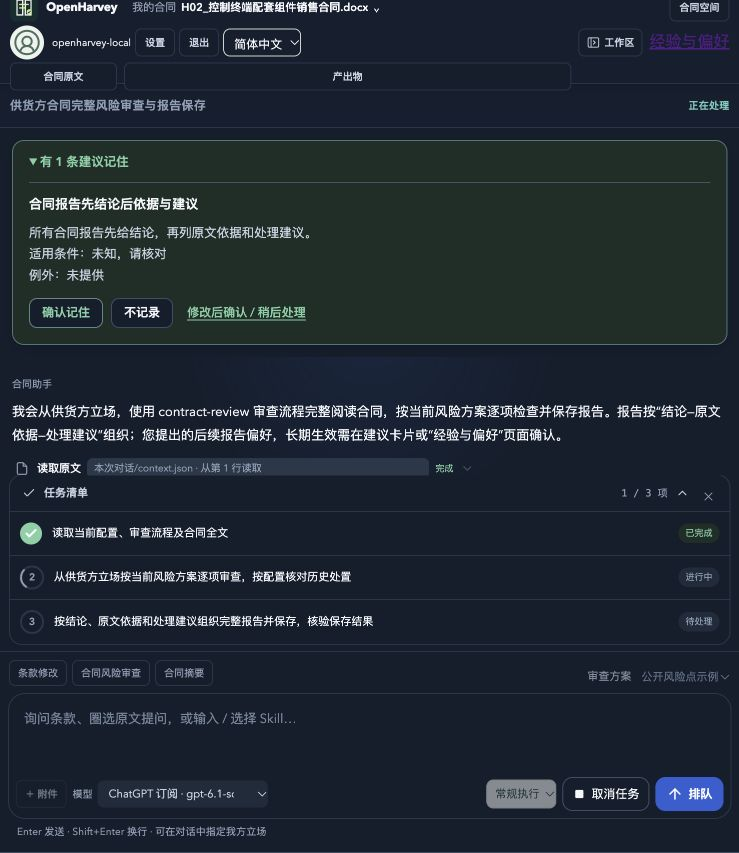
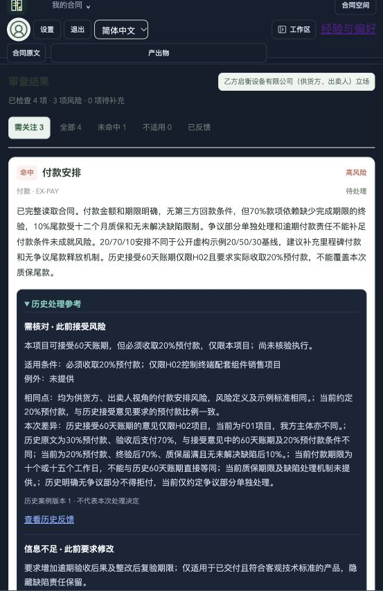
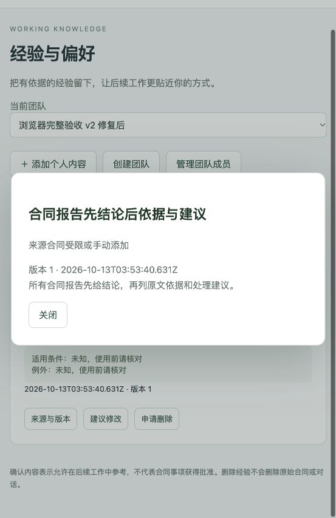

# contract-v2 本机部署与真实实验记录

日期：2026-10-13。**v2 已上线，核心及补充实验已执行；原始 judge 存在待复核项，整体不标记“完整验收通过”。**

工作台：http://127.0.0.1:8081/spaces 。账号 `openharvey-local`，登录文件：`~/.local/share/openharvey/contract-memory-lab/login.json`。合同 Core 8430、Proxy 8106，业务订阅桥接 8767，提炼桥接 8766。跨企业测试使用独立的 8082 应用实例。

业务、提炼、相关性判断、judge 均请求 ChatGPT 订阅 `gpt-6.1-sol`。实际结构化调用成功，CLI 为 `0.162.0-alpha.17.2`；CLI 未返回解析后的实际模型 ID，因此 `model_verified=false`。提炼与 judge 是独立会话、独立角色凭据，使用同一配置模型，不宣称独立模型交叉验证。普通 provider 检查使用已有 DeepSeek 直连。

## 执行结果

|路径|真实结果|
|---|---|
|原核心套件|27/27 步完成；原 9 用例及包哈希保持不变|
|三风险补充|16/16 步完成；真实反馈、三项并发召回、标准变更及相反角色排除|
|长期偏好与冲突|修复后新团队 14/14 步完成；回忆称呼、冲突提示、忽略、人工修改、409、更新后使用|
|L2 使用|4/4 步完成；两合同案例生成候选并确认，原生 Bash 实际调用 scenario/read，正文与正式条目一致|
|修订版本|3/3 步完成；修订稿以独立版本附件上传，实际读取并对照新旧材料|
|普通 provider|2/2 步完成；真实回答成功，当前测试作用域 L0 未新增|
|权限与发布|15 项通过；另有 3 项用户/Agent 标识校验通过|
|旧写入边界|4 个 Core 旧写入请求均 403；旧应用 memory API 410|
|来源与纠错|6 项通过；纠错更新、原报告不变、删除来源退出、恢复来源重校验|
|故障恢复|6 项通过；Proxy 错误、实际恢复回答、Core 停机反馈保留、幂等重试、提炼失败及恢复|
|重启|应用、Core、Proxy 已实际重启；原始记录、案例版本、正式条目和删除标记一致|
|历史 v1|9 条旧记录保留；16 个团队的旧版与 v2 正式列表无交集|
|浏览器|独立新团队上传 H02/F01、实际审查、候选确认、三项反馈、跨合同参考、原文定位、Word 下载、共享申请和审核发布|

基线包哈希：`3f301503aaef1e654a948e02973df6699f38c0ddf4230787d399d492e22d4d68`。补充清单及其哈希见 `supplemental-plan.json` 和 `acceptance.json`。全部业务写入通过应用接口；账户初始化使用管理员 CLI；诊断只读。未将私有金标、评分结果或数据库伪造记录写入记忆。

## 真实失败与修复

1. `core-01`：旧 `skill_root` 指向先前 worktree，而插件使用当前 checkout；历史脚本被固定路径校验拒绝。修正受管理本机运行配置的迁移，并保留 URL、密码与合同目录。新增迁移回归测试。
2. `core-02`：上游自动生成的云 Skill 与本地合同 Skill 重复，Agent 请求未授权 skill-bridge。合同专用部署现在仅注入/提取 `tdai-memory`，沿用 OpenHarvey 原生合同 Skills。
3. 浏览器初次 F01：三项并发相关性请求中，后两项碰到结构化桥接 429。订阅调用增加同请求 ID、同输入、原时限内的有界重试；503/其他错误不改用其他 provider。新团队并发实验及真实页面重查通过。
4. `preferences-01`：候选用模型原始主题做冲突比较，发布时才统一成“称呼语气”，漏掉变更冲突。改为比较前规范化，与发布采用同一主题规则；新增完整模拟管线及旧版本冲突测试。`preferences-02` 新团队重跑通过。

上述失败原始资料均保留在私有证据目录，没有覆盖成功结果或回拨问题日期。

## 原始评分与复核边界

原始已校验引用的 judge 为 **6 pass / 1 fail / 2 needs_review**，见 `judge-original-summary.json`。另一次初始评分因引用重新拼接 JSON 被校验拒绝，结果亦保留；没有把格式失败算通过。

- `V2-PREFERENCE`：judge 把“某次答复未出现昵称”及“助手回复解释确认流程”当作失败。需区分正式记忆正文和助手话语：实际两条 L3 正文没有流程说明；新团队明确回忆试验真实回答“大哥”，人工修改后真实回答“老师”；额外先查来源再核对正式约定亦使用最新“老师”。系统原有指令允许自然称呼，无须每次重复。原始 fail 不删除。
- `V2-BOUNDARY`：原评分认为缺少独立 Agent 隔离证据。补充实测跨团队 Agent 标识和伪造 user_id 403，以及 owner 无法读取同团队成员的个人条目。业务配置仍是每团队一个 Agent；未模拟同团队多个合同 Agent 的产品形态。
- `V2-PROTECTION`：judge 两次引用格式失败，保留为 needs_review。确定性检查及真实偏好补充流程验证了幂等、409、删除和人工保护，不能把引用失败改写成模型评估通过。

原核心确定性检查还存在一项测试工具误报：只看当前案例版本，把已确认候选引用的旧版本视为来源不存在。另建审计副本，用只读 `case_history` 证明旧版本仍在；原始步骤文件不改。审计副本还按消息 ID 补入原生工具结果，不加入该时点之后的消息，28 条条款定位均有实际 read 证据。

## 仍需如实区分的覆盖范围

- 实际观察到原生标题辅助请求跳过注入/记录；本轮没有自然触发原生 compaction，不把它列为真实通过。
- 修订稿作为独立版本附件测试；没有替换不可变主合同。新旧文档 ID、哈希与引用分别保留。
- 报告页历史检索独立于聊天模型选择；普通模型关闭新增聊天注入，不等于关闭报告/经验面板的读取。
- 原始报告保存后保持原内容；历史参考在独立区域更新。
- 有一致性停机备份及恢复记录，未执行破坏性回退演练。回退必须恢复配对的数据、配置及应用源码，不能只换旧 Core 镜像。
- 浏览器实测包含深色对话/参考卡片、浅色经验页及长文本；它不是对所有操作系统主题组合的穷举。

## 证据与操作

完整私有证据：`~/.local/share/openharvey/contract-v2-experiment/20261013/`（权限限制；不提交凭据、原始启动配置或模型完整输入）。包含备份、三轮核心运行、审计副本、judge 尝试、原生消息、补充运行、故障及恢复证据。Git 仅保存脱敏汇总、执行工具和合成材料的浏览器截图。

[机器可读验收](acceptance.json) · [镜像与配置摘要](deployment.json) · [启动与恢复说明](../../contract-memory-v2-deployment.md)

## UI 与记忆改动分离

2026-10-13 按用户指令分离。Antigravity 的 21 个 UI 文件独立提交到 codex/ui-style-consistency，并建立独立 worktree；基于共同 bc49476 保留既有记忆功能。在线应用在切分支期间先停止，主目录恢复 codex/contract-memory 后按计划启动，未合入 UI 提交。此前浏览器截图是执行时的事实记录，部分采集发生于共享目录有 UI 修改期间，不把它们当作最终记忆分支样式验收。分离后两分支的回归结果、归属和运行路径见 branch-separation.json；没有重跑已完成的真实实验。

分离后的在线只读核验：本人已确认偏好与团队已发布约定均显示正常，未发送新业务消息或重跑实验。最终面板截图见 final-memory-panel.jpg。
