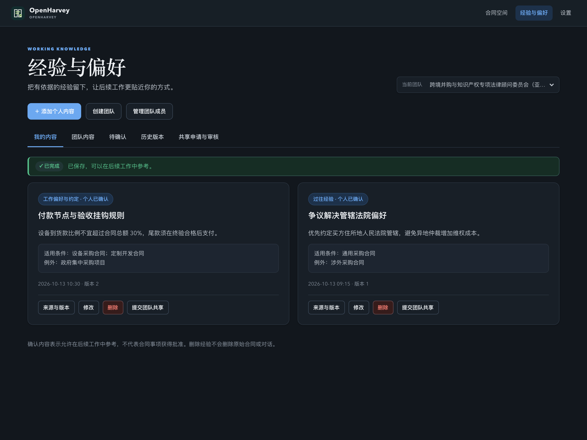
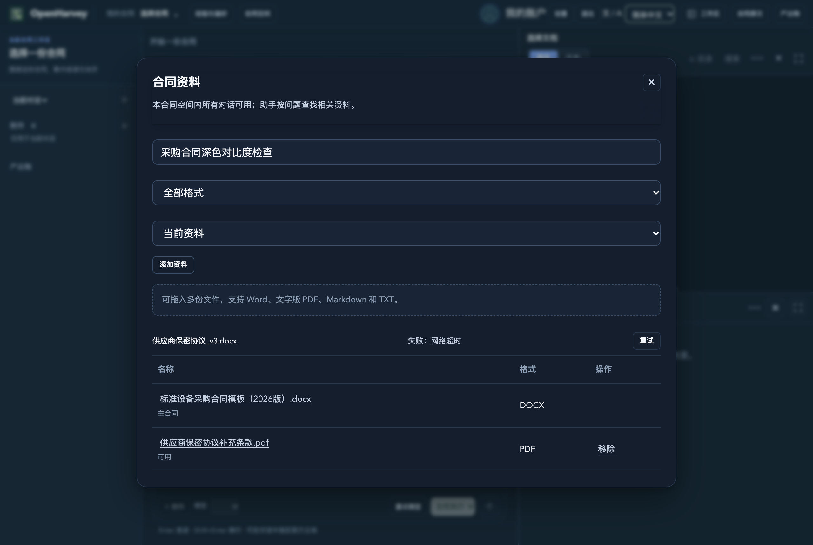

# UI 样式一致性独立交付

基于双方共同基线 `bc49476`，UI 代码提交 `03f34d4`。本分支未合入 `codex/contract-memory`，未作为本轮记忆在线服务的部署来源。

按 Antigravity 完成报告与实际 diff 核对 21 个文件：19 个修改的 static 文件、一个新增 confirm-dialog.js、一个 frontend.test.mjs。共享的 experience.js/html 保留基线已有的候选确认、版本检查、旧版历史、来源、审核与重试逻辑；增量归属 UI 状态、主题、按钮和对话框。逐 hunk 归属及文件哈希见 attribution.json。

独立 worktree 复核：前端 163/163、七组后端相关测试 74/74 通过。五个新增测试完整保留；只清理了新增文件末尾多余空行。

包括主题变量、响应式布局、资料弹窗尺寸、工作台按钮、经验面板状态与原生 dialog。以下图片来自 Antigravity 已完成的浏览器检查，不宣称在分离时重新执行了其浏览器测试；本轮未重跑已完成的记忆实验。

原始完整备份（含 ignored/untracked/.git、index、binary patches、refs、两个仓库 bundle 和报告）位于本机受限目录 ~/.local/share/openharvey/branch-separation-backups/20261013-125618。

## 四项回归修复

本节及修复报告记录验收时状态（当时尚未提交）；后续提交、合并以 Git 历史为准。后续修复及准确复合树验收见 [修复报告](fixes/README.md)。上面的归属与截图记录保留为 `03f34d4` 的历史证据；最新代码、测试、截图归属以 fixes/code-manifest.json 与 fixes/browser-results.json 为准。
