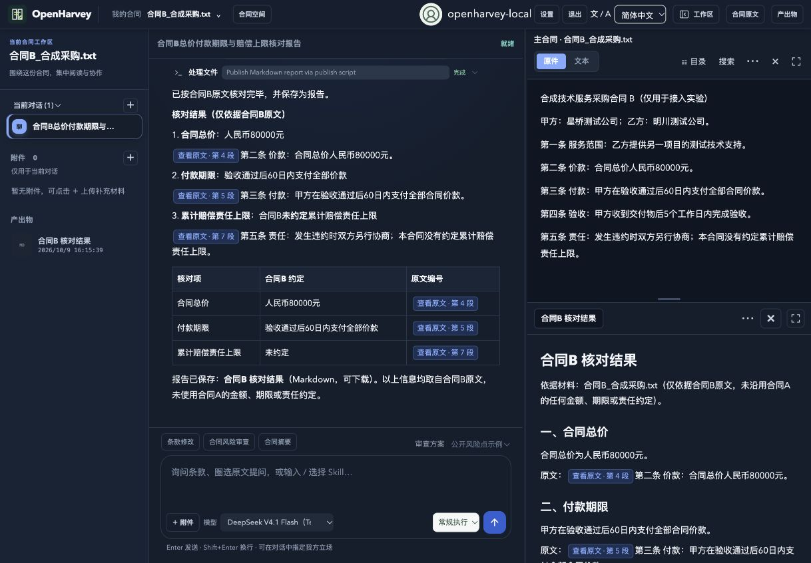
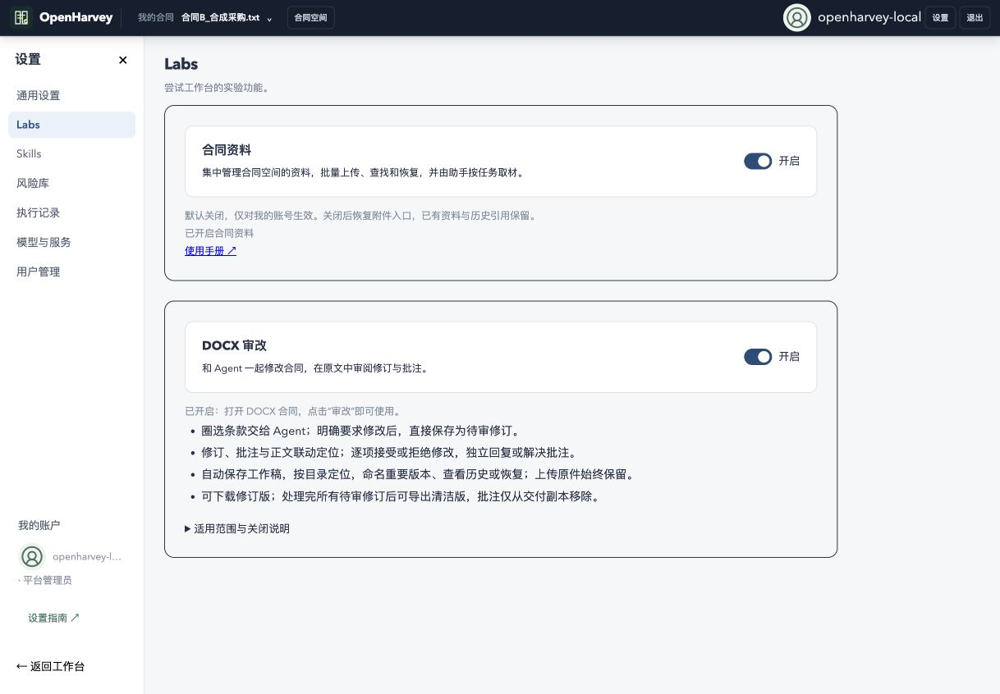

# OpenHarvey × TencentDB Memory 本机接入

实验分支：`codex/tencentdb-memory-integration`，从 OpenHarvey `main@81e55c5` 建立。独立 Memory 服务基于 `8b86874a`，沿用其 SQLite、默认 code 提示词和 L0–L3 数据形式。本机工作台地址：<http://127.0.0.1:8080/spaces>。

## 使用与启动

当前实验已创建账号 `openharvey-local`。本机浏览器通过显式本地预览设置自动登录；其他网络来源不能使用该自动登录入口。

先启动已部署的 TencentDB Memory 服务，然后在本分支工作区运行：

```sh
python3 -m pip install -r requirements.txt
npm ci
npm run build:memory
npm run build:redline
python3 scripts/run_tencentdb_local.py
```

本机现有 Python 3.12 环境可直接启动：

```sh
/Users/dicam/CodeDir/OpenHarvey/.venv/bin/python /Users/dicam/.codex/worktrees/tencentdb-memory-integration/OpenHarvey/scripts/run_tencentdb_local.py
```

启动入口默认复用 `/Users/dicam/.local/share/openharvey/tencentdb-experiment`，并使用此前隔离安装的 OpenCode 1.16.2。可通过 `--data`、`--port`、`--opencode-bin`、`--admin-key-file`、`--core-url`、`--proxy-url` 指定其他本地实验配置。服务已启动时不要再启动同一端口的实例；先停止已有 Web 进程，再运行启动命令。

选择 **DeepSeek V4.1 Flash（TencentDB Memory）** 使用独立记忆；选择普通 provider 使用普通模型链路。本次验收还配置了 **DeepSeek V4.1 Flash（直连，无记忆）**，便于直接切换测试。记忆不可用时任务明确报错，不自动切换到其他模型。

## Memory Hub 登录

访问 <http://127.0.0.1:8125/>，使用数据目录 `memory-login.json` 的 `user_key` 登录，找到 Team「OpenHarvey」、Agent「合同助手」。该身份是新建的专用身份，与旧 `local-memory-smoke`／「Contract Agent 实验」分开。

OpenHarvey 密码位置为数据目录的 `login.json`；Memory 用户 Key 和供应商 Key 不同。上游管理员 Key 只用于初始化，未复制到 Agent 目录。Memory provider 的 User Key 通过现有模型加密存储机制保存在控制端，并由 OpenCode 的独立认证目录持有。

## 接入行为

- 新增 `tencentdb-memory` provider，使用 `/opencode/default/v1/chat/completions`。
- Web 调度前验证 User Key、Agent 和 Task，生成当前 session ID 对应的绑定文件。插件通过 `chat.headers` 传递 Team／Agent／Task／Conversation；没有用户级“当前会话”全局变量。
- 账号身份和工作空间 Task 存于 `tdai_users`、`tdai_workspaces`。同一合同不同对话共用 Task，新合同使用不同 Task；映射在应用重启后继续使用。
- 绑定文件不含 Key，位于每个账号受管理的 `opencode/tdai-bindings`，以 0600 权限原子写入。其他 provider 的当前绑定设为关闭。
- 继续使用官方 Bash/curl 只读桥接。权限只放行所配置地址的六类只读端点；插件在执行前解析并重新构造命令，拒绝 shell 展开、管道、重定向、文件上传、其他地址、写入端点和身份／Task 覆盖。
- 标题和 compaction hook 不携带业务记忆会话头。SDK 类型与运行行为均已核对；标题请求在 Proxy 日志中作为辅助请求处理，compaction 头部行为有定向检查。
- Core 的 L2／L3 本来就是 Agent 层面的高层工作经验，不能把不同 Task 视为所有记忆层级的严格合同隔离。当前事实仍需读取当前合同，历史经验必须核对适用条件。

## 旧个人 Memory 移除

原个人 Memory 的工具、快照、执行能力凭证生成、写入／收集、Labs 编辑与引用／保存卡片均已移除。旧 `/api/memories`、`/internal/memory` 返回 410；Labs 不再接受 `memory_enabled`。

旧数据库行和历史对话正文不迁移、不删除，也不用于新任务。历史标记继续做展示清理；遗留能力文件仍受读取／编辑拒绝和日志脱敏保护。新实例不创建旧 Memory 专用表。

原文件承载的合同资料、DOCX Labs 开关和样式已拆出保留。E2B 的旧 Memory 插件、交换目录、同步与收集入口移除；普通 provider 的 E2B 路径继续通过回归测试，新的本机 Memory provider 在 E2B 下明确拒绝。

## 管理员配置入口

为已有本机管理员账号配置专用 Memory 身份：

```sh
python3 -m contract_web.cli --data /path/to/local-data tdai-connect openharvey-local \
  --admin-key-file /path/to/TencentDB-Agent-Memory/deploy/global-images/.admin-key
```

其他地址可用 `--core-url`、`--proxy-url`、`--service-id`；上游若使用自定义 gateway 凭据，使用 `--gateway-key-file`。重复连接会复用已有本机身份映射，不重新创建 User／Team／Agent。首次创建后继续使用同一数据目录及其加密主密钥。

## 验收与边界

本轮使用两份虚构合同：A 为 120000 元、验收后 30 日付款、责任上限为已收价款；B 为 80000 元、验收后 60 日付款、明确未约定累计责任上限。

- 从浏览器工作台上传、对话，实际读取合同原文并生成可定位引用。
- 长期报告结构及经验使用约定进入专用身份的 L0，经原生后台管线生成 L1／L2／L3。
- 同合同新对话自动执行 `atomic/search` 和 `scenario/read`，命中真实记录 ID，并返回来源。
- A、B 使用不同 Task；B 的答案与保存报告均依据 B 的 80000 元／60 日／未约定上限，未混用 A 的事实。
- Markdown 报告通过原有发布脚本收到真实 `saved=true` 回执，进入产出物区，保留原文定位。复合文件创建命令按原有一般命令规则仅作一次确认，未加入自动放行或同类永久授权。
- 切换到直连 provider 后，当前绑定关闭、记忆桥接规则移除，实际得到直连模型响应；该轮唯一验收标记没有出现在 Memory L0。
- Labs 页面只保留合同资料和 DOCX 审改，两个开关都已在实际界面验证。
- Web 应用已实际重启，账号／Agent／工作空间 Task 映射保持一致，原会话重新执行只读检索并返回同一报告结构记忆的记录 ID。
- 自动检查覆盖交错会话、Task 复用与错误拒绝、Proxy 故障、只读命令边界、旧接口／表退役和历史数据保留；项目完整 Python／前端检查及构建结果见验收记录。

运行包只导出插件入口函数，防止 OpenCode 的旧式插件加载器把辅助导出当成工厂而跳过插件。安全 curl URL 的引号写法也纳入了原生权限匹配回归检查。

本轮保留上游记忆引擎和默认提示词。默认抽取也会把部分测试中的检索要求提炼为工作方法；领域抽取质量与适用范围的进一步优化属于后续 TencentDB Memory 改造，不以本轮接入成功代替业务正确性保证。

最终检查：Python 328 项、前端 155 项均通过；`npm ci`、`build:memory`、`build:redline` 已完成。[结构化验收记录](evidence/tencentdb-memory/acceptance.json)保留版本、Task 对照、实测项目和边界。压缩请求的头部排除是定向 hook 检查，没有宣称执行过真实压缩基准。




